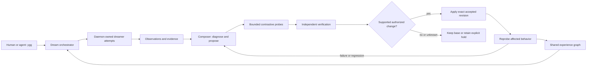

<!-- SPDX-License-Identifier: CC-BY-SA-4.0 -->
# Swarmharness2 roles and the correction loop

Status: engineering contract for the 4.0 architecture. A role description is
not evidence that its production loop is connected or effective.

## Names describe responsibility, not a GUI seat

Ygg is the operating interface. A desktop, web or mobile GUI is a client of
the same operating plane. Work, group, attempt, harness session, daemon
incarnation, review and evidence identities exist without a GUI projection.

| Harness² responsibility | Swarmharness2 responsibility | Required artifact or effect |
| --- | --- | --- |
| Agent execution | Dreamer / AgentWorker | Addressable attempt, retained session, resource record and criterion-bound result |
| Harness editor proposes changes | Composer: proposal | Authorized candidate against a named baseline, hypothesis and falsifier |
| Candidate probes | Bounded probe dreamers | Comparable executions with frozen inputs, coverage, costs and counterexamples |
| Harness composer combines variants | Composer: synthesis | Accept, revise, reject or keep-base decision supported by the behavioral contrast |
| Experience reflection | Composer: learning | Scoped lesson with cue, evidence, adopted revision, expiry and reversal conditions |
| Experience library | Shared experience graph | Retrievable lessons and sealed harness variants under the shared memory authority |
| Work scheduling | Dream orchestrator | Eligible work selected, supervised, rerouted or explicitly held |
| Bounded coordination | Admitted sub-orchestrator | Leased scope and hierarchy, drain and handback records |
| Context succession | Relay | Explicit predecessor/successor sessions carrying the same work obligation and open findings |

The owner's Composer combines the original harness-editor and
harness-composer responsibilities. The observation collector, detector,
model invocation, trial scheduler and decision recorder are components of
that responsibility. Naming a deterministic lesson miner `composer.py`
does not establish that the complete Composer exists.

The independent acceptance function remains mandatory. The configured
editor binding supplies an independent judgment within the Composer/review
process; a worker cannot provide its own acceptance receipt. This is a
separate use of “editor” from Harness²'s candidate-proposing harness editor.
Internal compatibility names may remain while public terminology converges.

## Required closed loop

Every arrow needs its own durable identity and readback. In particular,
proposal creation, a board post, an accepted plan, queue admission, process
exit, a patch, and a deployment are different events. None establishes
verified recovery by itself. The owner can inspect pending, blocked and
failed transitions through the same identifiers used by the Composer.

Repeated Composer runs are useful only when they contribute distinct
observations, interventions or verification. Replaying the same transcript
or obtaining agreement from more models is not an independent test.

## Completion, availability and efficiency

A terminal result requires the worker's accepted current subject, passing
applicable checks, independent acceptance of that subject, and explicit
closure or authorized deferral of every finding. Unavailable models,
missing evidence, quota exhaustion and owner stop retain the obligation;
they never produce acceptance. Supersession cannot erase an open finding.

Measure failure recurrence, proof deficit, time to verified recovery and
native resource consumption per accepted outcome. Report missing coverage,
provider accounting units and intervention cost. Utilization alone is not
useful work. “Gradient descent” describes a discrete improvement objective;
there is no demonstrated analytic gradient or guaranteed monotonic gain.
A favorable before/after result on one workload does not prove generality.

## Deployment acceptance

The following are separate gates:

1. Portable kernel conformance, including refusal and negative controls.
2. Each real adapter's source, identity, coverage and failure behavior.
3. Installed multi-host commands and daemon/harness lifecycle behavior.
4. A complete Composer incident-to-repair-to-reprobe example with an
   independently verified outcome and a retained failed/unknown control.
5. Repeated matched exposures showing lower unwanted behavior or lower
   measured cost, with confounders and uncertainty retained.

A passing gate cannot stand in for a later gate. The protocol's acceptance
store assumes trusted same-user control state; hash chains and HMAC receipts
are not a defense against an attacker who controls that store and its keys.
